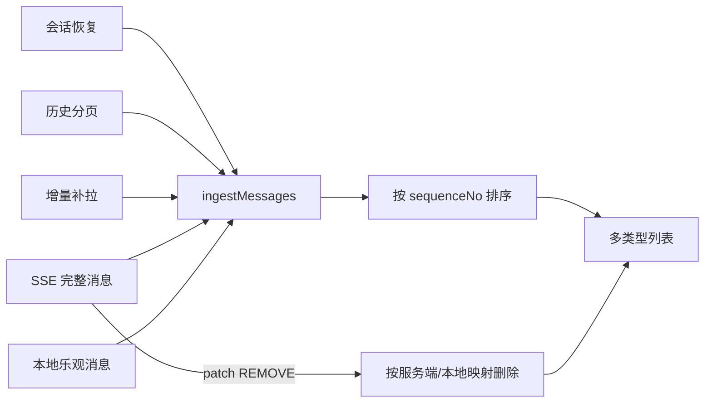

# 小虾聊天对话

## 目标

小虾对话是候选人端求职 Agent 的主交互入口。它以会话为载体，在同一消息流中承载文本与语音输入、业务卡片、历史恢复、SSE 实时结果和报告生成状态，并保持消息身份、顺序和交互状态一致。

## 范围与非目标

- 包含：会话进入与恢复、文本/卡片动作发送、语音识别结果接入、SSE 解析、历史分页、增量补拉、多类型消息渲染、终态替换、滚动和打字机状态。
- 不包含：通用 IM 的好友、群聊、已读、撤回和引用；本地聊天数据库；大模型生成逻辑；报告详情页自身业务。

## 当前事实与约束

- `ClawAgentViewModel` 持有 `sessionId`、`conversationId`、cursor、SSE request/sequence、内存 `messageStore` 和报告轮询 Job，是会话与消息状态的唯一页面级所有者。
- `ClawAgentMainFragment` 负责输入、卡片点击、键盘/滚动协调和观察列表；`ClawAgentMsgAdapter` 只负责类型映射、DiffUtil、ViewHolder 回调与打字机进度。
- `ClawAgentSseProcessor` 将 `message`、`snapshot` 和裸 `data` 解析为完整消息对象，而不是 token 增量；`patch` 当前只消费 `REMOVE`。
- 会话恢复、历史分页、增量补拉、SSE 和本地乐观消息最终都由 `ingestMessages()` 合并。渲染前按 `sequenceNo` 排序，不直接覆盖整份内存列表。
- 消息只保存在 ViewModel 内存；退出重置会清空消息与游标，ViewModel 清理时取消 SSE 和报告轮询。

## 目标设计

| 职责 | 所有者 | 不变量 |
| --- | --- | --- |
| 会话上下文与流状态 | `ClawAgentViewModel` | 会话未就绪时不得发送；取消后本地流必须停止 |
| 消息身份与顺序 | `messageStore` / `ingestMessages()` | 同一服务端消息只渲染一次；历史消息不能覆盖更新后的新状态 |
| SSE 事件解释 | `ClawAgentSseProcessor` | 解析层不操作 UI；未知事件不得被误当作业务消息 |
| 列表交互状态 | Adapter 与稳定消息 ID | RecyclerView 复用后，打字机和“是否末项”等状态仍可恢复 |
| 用户操作 | Fragment 回调到 ViewModel | ViewHolder 不直接请求接口或修改会话状态 |

所有消息来源必须经过同一合并入口；新增卡片类型只有在服务端消息语义、端侧类型映射、ViewHolder 回调和合并策略同时明确后才接入。

## 关键决策

- 用户文本先以 `clientMessageId` 乐观插入；服务端回显合并回同一端侧 ID，避免一次发送表现为删除再插入。服务端 messageId、cursor 和 sequenceNo 会映射回该 ID，以支持后续补拉和 `patch REMOVE`。
- `REPLACE_ON_TERMINAL` 与 `DISMISS_ON_TERMINAL` 由消息仓库执行，而不是由 ViewHolder 隐藏；这样历史恢复、实时流和重新绑定得到同一结果。
- 简历流程卡和端侧自我介绍卡只保留最新有效实例，历史分页不得回滚当前流程状态。
- 列表内容无变化时不重复派发，是否贴底在提交新列表前判断；用户浏览历史时不强制滚到底部。

## 关键流程与状态

发送链路为：校验会话 → 插入本地用户消息 → 复用统一 SSE 接口发送文本或动作 → 解析 meta/message/patch/done → complete 后增量补拉兜底。历史加载使用独立的 `loadingHistory` 和 `hasMoreHistory` 防止并发与越界翻页。

## 失败与恢复

- 进入会话失败后开放刷新；会话 ID 缺失时，发送和补拉直接终止，不创建无上下文请求。
- SSE `complete` 会移除末尾残留思考态并补拉最新 cursor；显式取消在 requestId 可用时同时通知服务端，并始终取消本地收集。
- 历史分页通过 completion 回调复位 `loadingHistory`，覆盖业务错误之外的 IO/解析异常。
- SSE 错误当前只退出 streaming 并暴露错误，不执行 complete 的末尾思考态清理与补拉；恢复语义尚未统一。

## 契约与依赖

- 接口路径与请求模型：`app/src/main/java/com/shiyuan/fastclaw/core/network/apis/`。
- 原始流生命周期：`app/src/main/java/com/shiyuan/fastclaw/core/network/sse/RawSSEStreamHandler.kt`。
- 事件解析：`app/src/main/java/com/shiyuan/fastclaw/core/network/sse/processor/ClawAgentSseProcessor.kt`。
- 服务端消息字段和 display policy 是协议事实；本文不复制完整 Schema。

## 验收与验证

- 同一用户消息经过乐观插入、SSE 回显和补拉后仍只有一个稳定 item。
- 中间态按 display policy 正确保留、替换或移除，`patch REMOVE` 也能删除已映射到本地 ID 的用户消息。
- 历史与实时消息并发到达后顺序稳定，旧流程卡不能覆盖新卡，列表无实际变化时不重复滚动。
- 离屏再回屏不会重播已展示文本；最后一项变化会触发依赖位置的卡片重新绑定。
- 会话未就绪、SSE 错误、取消、历史加载异常和 ViewModel 清理均有可观察的终止或恢复行为。

当前验证证据为对 ViewModel、Fragment、Adapter、SSE processor 与 API 声明的静态核对；仓库未发现覆盖该功能的单元或仪器测试。本次未运行 Gradle。

## 实现对齐

| 关注点 | 稳定代码锚点 | 状态或偏差 |
| --- | --- | --- |
| 会话、合并与恢复 | `app/src/main/java/com/shiyuan/fastclaw/feature/clawagent/ClawAgentViewModel.kt` | complete：统一内存仓库、历史/增量/SSE 合并、乐观消息映射已实现 |
| SSE 分发与取消 | `app/src/main/java/com/shiyuan/fastclaw/core/network/sse/` | in-progress：主要事件与本地/服务端取消已实现，错误恢复语义未统一 |
| 多类型列表与输入体验 | `app/src/main/java/com/shiyuan/fastclaw/feature/clawagent/` | in-progress：DiffUtil、打字机、滚动和 Insets 已实现，仍需多机型动态验证 |
| 报告生成轮询 | `app/src/main/java/com/shiyuan/fastclaw/feature/clawagent/ClawAgentViewModel.kt` | in-progress：Job 受 ViewModel 生命周期管理，卡片被替换后旧轮询的及时终止仍需验证 |

## 风险与待确认问题

- `sendMessage()`、`sendAction()` 会记录完整请求体，SSE 解析失败或未知事件也可能记录完整 data；需要明确线上日志裁剪与脱敏策略，否则可能暴露用户输入或业务标识。
- 需要确定 SSE error 是否与 complete 一样清理残留思考态并执行 cursor 补拉；当前两条路径行为不同。
- 报告生成卡被替换或移除时，当前消息合并不会直接取消对应轮询 Job；需要以服务端任务是否仍需后台跟踪为依据确定终止规则。
- 键盘、全屏手势、列表末项替换和大批量插入的滚动稳定性依赖设备行为，静态检查无法替代真机验证。
