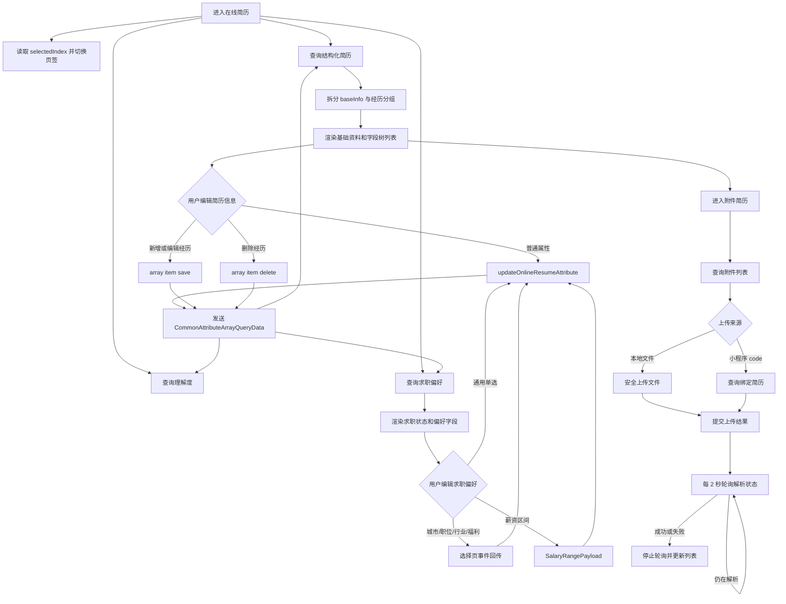

# 在线简历功能需求分析和梳理

## 1. 需求背景

在线简历是候选人端集中维护个人求职资料的入口，也是小虾理解用户、生成分析结果和提供求职建议的基础数据来源。

本功能不等同于单份附件简历。当前系统同时维护三类数据：

- 结构化简历信息：基础资料、自我评价、工作经历、项目经历、教育经历、技能、证书和奖项等。
- 求职偏好：求职状态、期望城市、期望职位、期望行业、期望薪资及其他择业偏好。
- 附件简历：用户上传的原始简历文件及其解析任务状态。

页面顶部展示“小虾理解度”，用于反馈当前资料与小虾的对齐程度。用户修改结构化字段后，客户端重新查询相关页面数据和理解度，保证展示结果与服务端一致。

## 2. 已确认的产品边界

| 事项 | 当前口径 |
| --- | --- |
| 页面容器 | `OnlineResumeActivity` 承载理解度、双页签和附件简历入口 |
| 页面页签 | 0 为“简历信息”，1 为“求职偏好”，启动参数会限制在 0～1 |
| 数据来源 | 结构化简历、求职偏好、理解度和附件简历均以服务端数据为准 |
| 结构化模型 | 服务端按 section、attribute group、field tree 和 field item 分层返回 |
| 简历信息编辑 | 基础资料和普通字段走属性更新；可重复经历走数组项新增、编辑、删除 |
| 求职偏好编辑 | 单选字段复用通用弹窗；城市、职位、行业、福利和薪资使用独立选择器 |
| 保存后刷新 | 编辑页保存成功后发送 `Events.CommonAttributeArrayQueryData`，页面重新查询数据，Activity 重新查询理解度 |
| 附件简历 | 支持本地文件上传、小程序回传、替换、失败项删除和解析状态轮询 |
| 上传影响 | 当前页面文案明确：重新上传附件简历会覆盖现有简历信息，但不影响求职偏好 |
| 本地存储 | 页面不在本地数据库持久化在线简历，主要依赖接口重新查询和页面内 LiveData |
| 登录要求 | “我的”页面入口会先做登录拦截；聊天卡片入口直接打开目标页 |

## 3. 页面与功能能力

### 3.0 在线简历主页面

`OnlineResumeActivity` 是在线简历的总容器，负责顶部理解度展示、双页签切换和附件简历入口。

页面能力：

- 展示“小虾理解度”百分比和波浪进度。
- 展示“简历信息”和“求职偏好”两个页签。
- 支持点击页签或左右滑动切换页面。
- 支持从不同入口直接打开指定页签。
- 在“简历信息”页签展示“附件简历”入口。
- 顶部区域随内容滚动折叠。

当前系统能力：

- 使用 `ViewPager2 + FragmentStateCacheAdapter` 承载两个 Fragment。
- `tableOnlineResumeIndex` 同步点击切换、滑动切换和启动参数。
- `offscreenPageLimit = 2`，进入页面后两个页签都会被保留。
- 选中“简历信息”时显示附件简历入口，选中“求职偏好”时隐藏。
- 页面销毁时注销 `OnPageChangeCallback`。

当前行为说明：

- 当服务端理解度为 0 时，进度波浪最低按 10 展示，但文字仍显示 `0%`，这是当前刻意保留的视觉兜底。
- 页签状态由 Activity 与 ViewModel 双向同步，不依赖 Fragment 自己维护选中态。

### 3.1 页面入口与默认页签

在线简历支持从“我的”和小虾聊天中的多个位置进入。

当前入口：

- “我的”页面头像、姓名、理解度区域、简历编辑区域：打开“简历信息”。
- “我的”页面求职偏好区域：打开“求职偏好”。
- 小虾聊天顶部“对你的理解”：打开“简历信息”。
- 简历上传成功卡：打开“简历信息”。
- 理解度摘要卡的详情区域：打开“简历信息”。
- 理解度摘要卡的对齐度区域：打开“求职偏好”。
- 其他小虾卡片中的简历或理解入口：默认打开“简历信息”。

当前系统能力：

- `OnlineResumeActivity.start(context, selectedIndex)` 统一处理跳转。
- `selectedIndex` 在写入 Intent 和读取 Intent 时都会执行 `coerceIn(0, 1)`，避免非法页签索引。

### 3.2 小虾理解度

理解度用于描述当前在线简历与小虾所需求职信息的对齐程度。

页面能力：

- 进入在线简历时查询最新理解度。
- 以百分比和波浪进度展示结果。
- 任一结构化字段更新后重新查询理解度。

当前系统能力：

- `InformationViewModel.understandingScore()` 调用理解度查询接口。
- Activity 首次创建时发起查询。
- Activity 监听 `Events.CommonAttributeArrayQueryData`，收到字段更新事件后再次查询。

差异点：

- 附件简历上传成功当前发送的是 `Events.ResumeEvent(true)`，在线简历 Activity 没有监听该事件，因此返回主页面后理解度不一定立即刷新。
- 理解度数值直接交给进度控件，客户端没有显式限制到 0～100，依赖服务端返回合法范围。

### 3.3 简历基础资料

“简历信息”页顶部展示用户的基础资料，并提供统一编辑入口。

页面能力：

- 展示头像、姓名、年龄、性别。
- 展示手机号、邮箱和微信号。
- 学生身份展示身份标签。
- 点击头像编辑按钮或基础资料卡进入个人信息编辑页。

当前系统能力：

- `ResumeInfoFragment` 从 `baseInfo` section 中拆出基础资料。
- 字段同时兼容 `attributeGroupCode` 和 `metaCode`。
- 展示值优先使用 `displayValue`，其次从 Map 的 `displayText`、`name`、`value` 中回退，最后使用原始值。
- 头像为空或加载失败时使用默认头像。
- 姓名为空显示“姓名”；年龄为空显示 `0岁`；性别和联系方式为空显示“未知”。
- 年龄字段已经带“岁”时不重复追加单位。
- 仅 `jobIdentity == 学生` 时显示学生标签。

编辑链路：

- 普通基础字段由 `PersonalInformationActivity` 调用 `updateOnlineResumeAttribute()` 保存。
- 头像先通过安全上传链路获得文件地址，再调用 `updateAvatar()` 更新用户头像。
- 保存成功后发送公共刷新事件，重新查询在线简历和理解度。

### 3.4 结构化简历分组

“简历信息”页按服务端分组展示自我评价和可重复的经历类数据。

当前支持的分组：

| 分组 | 分组编码 | 展示与编辑方式 |
| --- | --- | --- |
| 自我评价 | `selfEvaluation` | 外层直接展示文本，进入个人描述页编辑 |
| 工作经历 | `workExperience` | 展示公司、职位、时间、工作内容，支持新增、编辑、删除 |
| 项目经历 | `projectExperience` | 展示项目、角色、时间、职责，支持新增、编辑、删除 |
| 教育经历 | `educationInfo` / `educationExperience` | 展示学校、专业、学历、时间，支持新增、编辑、删除 |
| 技能 | `skills` / `skill` | 展示技能名和熟练度，支持新增、编辑、删除 |
| 证书 | `certificates` / `certificate` | 展示证书名，支持新增、编辑、删除 |
| 奖项 | `awards` / `award` | 展示奖项名，支持新增、编辑、删除 |

当前系统能力：

- 外层 `RecyclerView` 每项对应一个属性分组，内层 `RecyclerView` 展示该分组的 `fieldTree` 实例。
- 分组标题优先使用 `attributeGroupName`，缺失时回退到字段树名称或分组编码。
- `passable == false` 时展示“待补充”，`null` 不按校验失败处理。
- 服务端使用 `instanceIndex = -1` 表示新增占位模板，该项不作为真实经历展示。
- 技能、证书和奖项超过 3 条时默认折叠，支持展开全部和收起全部。
- 工作、项目、教育经历始终展示完整列表。
- 未识别的分组不会创建内部列表适配器。

### 3.5 简历分组的新增、编辑与删除

可重复经历通过同一套字段树模型完成新增、编辑和删除。

新增链路：

1. 用户点击分组右侧新增按钮。
2. `ResumeInfoFragment` 复制首个字段树模板。
3. 客户端清空模板中的 `fieldValue` 和 `displayValue`。
4. 将空模板插入第 0 位，并以在线简历模式打开对应编辑页。
5. 保存时设置 `operation = CREATE` 并调用数组项保存接口。

编辑链路：

1. 用户点击某条经历。
2. 页面把当前分组、目标位置和请求 ID 传给对应编辑页。
3. 编辑页修改目标 `fieldTree`。
4. 保存时设置 `operation = UPDATE` 并调用数组项保存接口。

删除链路：

1. 用户在编辑页触发删除。
2. 客户端提交 `attributeGroupCode + instanceIndex`。
3. 删除成功后发送公共刷新事件。

当前系统能力：

- 工作、项目、教育、技能、证书和奖项编辑页通过 `WorkActivity.TYPE_ONLINE_RESUME` 区分在线简历保存链路。
- `InformationViewModel.onResumeInfoAttributeSave()` 统一处理 CREATE/UPDATE。
- `InformationViewModel.onlineResumeAttributeDelete()` 统一处理数组项删除。
- 编辑页监听保存结果并发送 `Events.CommonAttributeArrayQueryData`，`ResumeInfoFragment` 收到后重新查询整份在线简历。

差异点：

- 新增依赖服务端至少下发一个可复制的字段树模板；如果 `fieldTree` 为空，当前新增入口无法构造表单数据。
- 新增前会直接向当前 `fieldTree` 插入空模板，刷新前该内存对象已经发生变化，需要避免重复点击导致连续插入多个空模板。

### 3.6 求职偏好

“求职偏好”页按 section 展示求职状态和各类择业条件。

页面能力：

- 单独展示和修改求职状态。
- 展示字段当前值和“待完善”状态。
- 支持期望城市、职位、行业、薪资、福利等专用选择能力。
- 支持工作类型、离职原因、职业方向、办公模式等字典单选能力。

当前字段与编辑方式：

| 字段 | 编码 | 编辑方式 |
| --- | --- | --- |
| 求职状态 | `jobStatus` | 通用单选弹窗，成功后额外发送 `JobSearchStatusEvent` |
| 期望城市 | `expectedCity` | 城市选择页，多选结果回传 |
| 期望职位 | `jobIntention` | 职位选择页，最多 10 项 |
| 期望行业 | `expectedIndustry` | 行业选择页，多选结果回传 |
| 期望薪资 | `expectedSalary` | 薪资区间选择器 |
| 福利偏好 | `welfarePreference` | 福利选择页，多选结果回传 |
| 工作类型 | `jobType` | 通用单选弹窗 |
| 离职原因 | `latestLeavingReason` | 通用单选弹窗 |
| 职业方向 | `careerDirection` | 通用单选弹窗 |
| 办公模式 | `workMode` | 通用单选弹窗 |
| 是否接受外派 | `acceptRelocation` | 通用单选弹窗 |
| 工作制度偏好 | `workSchedulePreference` | 通用单选弹窗 |
| 是否接受加班 | `overtimeAcceptance` | 通用单选弹窗 |
| 公司规模偏好 | `companyScalePreference` | 通用单选弹窗 |
| 薪资结构偏好 | `salaryStructurePreference` | 通用单选弹窗 |
| 团队氛围偏好 | `teamAtmospherePreference` | 通用单选弹窗 |
| 求职身份 | `jobIdentity` | 通用单选弹窗 |

当前系统能力：

- `queryJobPreferencesInfo()` 按 `OnlineResumeInfoSection` 返回分组数据。
- 求职状态使用顶部特殊卡片；其他分组通过内部字段列表展示。
- 单选项来自服务端 `options`，保存时同时提交 `code` 和 `name`。
- 城市、职位、行业和福利通过 `Events.ClawAgentEvent` 回传 JSON，客户端解析为 `InterviewJobData` 列表后提交。
- 多选字段使用 `DICT_MULTI`，普通单选使用接口字段自身的 `inputMode`。
- 更新成功后发送公共刷新事件，重新查询求职偏好和理解度。

差异点：

- `ClawAgentEvent` 的 `when` 分支将所有未命中的事件类型都按“福利偏好”处理。若页面存活期间收到其他类型事件，可能错误更新 `welfarePreference`，建议后续改为只接受明确的福利完成事件。
- 多选回传会记录完整 JSON 调试日志，正式环境需要确认不会输出不必要的用户求职偏好数据。

### 3.7 附件简历

附件简历用于上传原始文件并触发服务端解析。入口位于“简历信息”页签底部，点击后进入 `MyResumeActivity`。

页面能力：

- 查询并展示当前附件简历列表。
- 无附件时展示上传按钮。
- 支持从本地选择文件上传。
- 支持从小程序选择简历后返回 App 继续提交。
- 支持替换已解析成功的简历。
- 支持删除解析失败的简历任务。
- 展示解析中、解析成功和解析失败状态。
- 解析中自动轮询最新状态。

当前状态口径：

| `parseStatus` | 页面表现 | 可执行操作 |
| --- | --- | --- |
| `0`、`1` | 展示解析中状态和状态文案 | 自动轮询，暂不展示替换或删除入口 |
| `2` | 展示正常简历图标、名称和更新时间 | 可发起替换上传 |
| 其他值 | 展示失败样式和失败文案 | 可删除该任务 |

本地文件上传链路：

1. `UploadResumeDialog` 返回本地文件 URI 和文件名。
2. `uploadFilesWithSecurityCheck()` 使用在线简历附件业务类型执行安全上传。
3. 上传成功后取得文件地址。
4. `submitResumeUpload()` 提交文件地址、文件名和可选的替换任务 ID。
5. 服务端接受后发送 `Events.ResumeEvent(true)` 并启动解析状态轮询。

小程序回传链路：

1. 上传弹窗返回小程序授权 code。
2. Activity 在 `onResume()` 中查询 code 绑定的简历信息。
3. 使用返回的文件地址、文件名和任务业务 ID 调用同一提交接口。
4. 查询完成后 ViewModel 清空 code，避免重复提交。

轮询机制：

- 使用 `Handler + Runnable` 每 2 秒调用一次 `queryResumeList()`。
- 列表中存在 `parseStatus = 0/1` 的任务时启动轮询。
- 所有任务离开解析中状态后停止轮询。
- `isResumePolling` 防止重复启动。
- Activity 销毁时移除回调并停止轮询。

差异点：

- 上传成功后在线简历主页面没有监听 `ResumeEvent`，而附件上传又可能覆盖结构化简历信息；用户返回时主页面可能继续显示上传前的缓存数据，直到再次触发查询或重新进入页面。
- 轮询查询当前使用带 Loading 的请求封装，每 2 秒触发时需要确认不会造成重复 Loading 或交互闪烁。
- 轮询只在 `onDestroy()` 停止，Activity 进入后台但未销毁时仍可能继续执行。

### 3.8 空态与刷新策略

页面能力：

- 服务端未返回结构化简历或求职偏好时展示空态引导。
- 请求成功后切换到真实内容。
- 任一编辑页保存后重新请求完整页面数据。
- 新数据到达后重置列表局部展开状态。

当前系统能力：

- 两个 Fragment 在首次请求前都先提交空列表并展示空态。
- `ResumeInfoFragment` 根据在线简历查询结果分别更新基础资料和经历分组。
- `JobPreferencesFragment` 按 section 更新整个求职偏好列表。
- 简历信息刷新时会清空技能、证书和奖项的展开状态，恢复默认折叠。
- 公共事件同时驱动当前页面数据、另一个页签数据和理解度更新。

差异点：

- 当前空列表同时承担“正在请求”和“确实无数据”两种状态，请求返回前会短暂显示空态。
- 公共事件为 sticky 事件，页面重建或多个观察者同时存活时需要关注重复消费和重复请求。

## 4. 核心数据与接口

### 4.1 核心数据结构

| 数据结构 | 作用 |
| --- | --- |
| `OnlineResumeInfoData` | 在线简历或求职偏好的顶层响应，包含多个 section |
| `OnlineResumeInfoSection` | 页面分组，包含 `sectionCode`、`sectionName` 和字段列表 |
| `AttributeArrayQueryData` | 一个属性组或普通字段，包含编码、输入模式、展示值、选项和字段树 |
| `AttributeFieldTree` | 工作/项目/教育等可重复实例，使用 `instanceIndex` 标识具体记录 |
| `AttributeFieldItem` | 实例中的具体字段，支持递归子字段 |
| `OnlineResumeAttributeUpdateBody` | 普通属性更新请求，包含字段组编码、输入模式和值 |
| `ResumeListData` | 附件简历列表项，包含任务 ID、名称、更新时间和解析状态 |

### 4.2 主要接口

| 能力 | ViewModel / API 方法 | 接口路径 |
| --- | --- | --- |
| 查询理解度 | `understandingScore()` | `/api/candidate/app/jobAgent/understanding/score/query` |
| 查询简历信息 | `queryOnlineResumeInfo()` | `/api/candidate/app/jobAgent/onlineResume/info/query` |
| 查询求职偏好 | `queryJobPreferencesInfo()` | `/api/candidate/app/jobAgent/onlineResume/preference/query` |
| 更新普通属性 | `updateOnlineResumeAttribute()` | `/api/candidate/app/jobAgent/onlineResume/attribute/update` |
| 保存数组项 | `onlineResumeAttributeSave()` | `/api/candidate/app/jobAgent/onlineResume/attribute/array/item/save` |
| 删除数组项 | `onlineResumeAttributeDelete()` | `/api/candidate/app/jobAgent/onlineResume/attribute/array/item/delete` |
| 查询附件简历列表 | `queryResumeList()` | `/api/candidate/app/jobAgent/resume/list/query` |
| 提交附件简历 | `submitResumeMyUpload()` | `/api/candidate/app/jobAgent/resume/my/upload/submit` |
| 删除附件简历 | `deleteResume()` | `/api/candidate/app/jobAgent/resume/list/delete` |
| 查询小程序回传简历 | `queryCodeResumeBinding()` | `/api/candidate/miniProgram/codeResumeBinding/query` |

## 5. 核心业务流程

## 6. 与当前系统能力的匹配情况

| 需求模块 | 当前能力 | 是否满足 | 说明 |
| --- | --- | --- | --- |
| 指定页签进入 | `OnlineResumeActivity.start()` | 满足 | 支持 0/1 页签并限制非法索引 |
| 理解度展示 | `understandingScore()` + `WaveProgressView` | 基本满足 | 结构化字段更新后可刷新，附件上传后缺少直接刷新 |
| 基础资料展示 | `ResumeInfoFragment` | 基本满足 | 已覆盖头像、姓名、年龄、性别和联系方式兜底 |
| 基础资料编辑 | `PersonalInformationActivity` | 基本满足 | 普通字段和头像均已接入保存链路 |
| 自我评价 | `PersonaDescriptionActivity` | 满足 | 支持展示和编辑 |
| 可重复经历 | 多个经历编辑 Activity | 基本满足 | 支持新增、编辑、删除，依赖服务端字段模板 |
| 折叠展开 | `expandedGroupCodes` | 满足 | 技能、证书、奖项超过 3 条可展开 |
| 求职状态 | 单选弹窗 + 状态事件 | 满足 | 保存后同步状态相关页面 |
| 求职偏好多选 | 独立选择页 + 事件回传 | 基本满足 | 需收紧未识别事件的兜底分支 |
| 薪资区间 | `SalaryRangePickerDialog` | 满足 | 已转换为接口约定 payload |
| 保存后刷新 | 公共 sticky 事件 | 基本满足 | 能统一刷新，但需关注重复消费和重复请求 |
| 附件本地上传 | 安全上传 + 提交接口 | 基本满足 | 已支持上传、替换和错误提示 |
| 小程序回传 | code 查询 + 提交接口 | 基本满足 | 已在 `onResume()` 衔接回传链路 |
| 附件解析状态 | 2 秒轮询 | 基本满足 | 已防重复并在销毁时停止，后台生命周期仍需关注 |
| 空态展示 | 两个 Fragment 的空态视图 | 部分满足 | 暂未区分加载中和真实空数据 |

## 7. 当前不包含的能力

- 不在本地数据库保存在线简历草稿或历史版本。
- 不支持在线简历版本对比、撤销修改和恢复历史版本。
- 不提供整份结构化简历的统一预览或导出能力。
- 不在当前主页面直接编辑所有字段，复杂字段仍跳转独立 Activity 或 Dialog。
- 不在客户端计算理解度，分值完全由服务端返回。
- 不在附件简历页面展示解析后的完整结构化内容，只展示文件和解析任务状态。
- 不支持离线编辑和网络恢复后的自动补交。
- 不在前端定义服务端字段顺序和完整性规则，主要依赖 section、fieldTree、passable 和 options。

## 8. 后续设计与实现关注点

- 附件简历上传成功后，应通知 `OnlineResumeActivity` 重新查询结构化简历、求职偏好和理解度，避免返回后展示旧数据。
- `ClawAgentEvent` 应只处理明确匹配的城市、职位、行业和福利事件，不应把未知事件默认当作福利结果。
- 新增经历依赖服务端字段模板，需要明确 `fieldTree` 为空时的产品提示和兜底方案。
- 需要防止新增按钮连续点击向同一字段树插入多个空模板。
- 公共 sticky 事件可能同时触发两个 Fragment 和 Activity 请求，需要评估是否存在重复消费或短时间重复请求。
- 真实空态与首次加载态应分离，避免页面进入时短暂展示“暂无数据”。
- 附件解析轮询应与可见生命周期绑定，并确认轮询请求不会反复显示全局 Loading。
- 需要确认附件上传“覆盖简历信息、不影响求职偏好”的服务端实际行为，并在覆盖完成后刷新所有受影响页面。
- 理解度应明确 0 分时波浪最低展示 10 的视觉规则，并对异常分值进行 0～100 限制。
- 求职偏好多选结果、附件上传信息等调试日志需要按线上隐私要求收敛。
- 新增服务端分组或字段编码时，需要同步确认展示适配器、编辑入口、输入模式、回传事件和保存接口是否完整覆盖。
