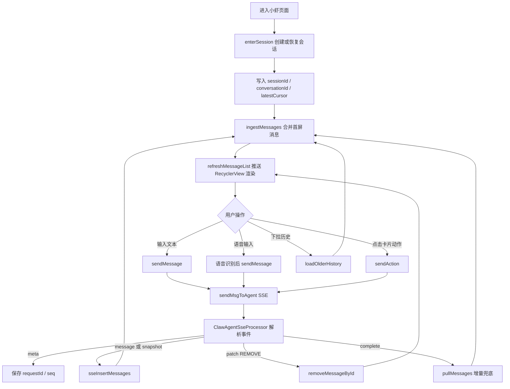

# 小虾聊天对话功能需求分析和梳理

## 1. 需求背景

小虾聊天对话是候选人端求职 Agent 的主交互入口。用户通过文本、语音、问题卡、表单卡、简历上传卡和底部快捷入口与小虾完成求职信息补全、简历诊断、公司背调、模拟面试、面试通关包等任务。

本功能不等同于普通 IM 聊天。它以会话为载体，承载服务端 SSE 流式输出、卡片动作提交、消息替换、历史恢复、增量补拉和多种业务卡片渲染。前端需要保证聊天体验连续、卡片状态准确、消息滚动稳定，并在服务端主动推送或补拉消息时保持列表状态一致。

## 2. 已确认的产品边界

| 事项 | 当前口径 |
| --- | --- |
| 页面入口 | 复用候选人端小虾主页面，由 `ClawAgentMainFragment` 承载 |
| 会话体系 | 复用后端小虾会话体系，依赖 `sessionId`、`conversationId`、`latestCursor`、`lastSeq` 等上下文 |
| 消息来源 | 支持进入会话返回、历史分页、增量拉取、SSE 实时消息和本地预置消息 |
| 用户输入 | 支持文本输入、语音识别后发送、问题卡选择、卡片按钮点击和快捷入口触发 |
| 流式输出 | 文本消息和卡片动作统一通过 SSE 链路返回增量消息 |
| 卡片展示 | 前端按服务端消息类型和卡片类型映射为不同 ViewHolder 展示 |
| 消息替换 | 支持 `REPLACE_ON_TERMINAL`、`DISMISS_ON_TERMINAL` 和 `patch REMOVE` 等服务端替换/移除语义 |
| 本地缓存 | 当前聊天列表主要维护在 ViewModel 内存 `messageStore`，不做本地数据库聊天记录 |
| 体验目标 | 新消息贴底、旧消息不重复流式输出、键盘不遮挡输入区、非底部显示回到底部按钮 |

## 3. 原型覆盖的页面与能力

### 3.0 小虾主对话页

小虾主对话页用于承载用户与 Agent 的完整对话过程，是消息列表、快捷入口、输入区和顶部状态的组合页面。

页面能力：
- 展示小虾头像、昵称和求职状态。
- 展示“小虾对你的理解”入口。
- 展示聊天消息列表。
- 支持下拉加载更早历史消息。
- 支持底部输入文字并发送。
- 支持语音输入。
- 支持底部快捷入口，例如公司背调、测简历、测薪资、面试通关包、模拟面试。
- 当列表不在底部时展示“滚动到底部”按钮。

当前系统能力：
- 当前已有 `ClawAgentMainFragment` 作为小虾主页面。
- 当前已有 `RecyclerView + ClawAgentMsgAdapter` 承载消息列表。
- 当前已有 `SmartRefreshLayout` 加载更早历史。
- 当前已有底部输入区、语音录制 Dialog、快捷入口列表和滚动到底部按钮。

差异点：
- 小虾对话页不是静态卡片页，消息列表会被 SSE、增量补拉和历史分页共同更新。
- 需要重点保证列表刷新和自动滚动稳定，避免新增或替换最后一条消息时出现抖动。
- 底部快捷入口需要与键盘展开状态联动，键盘真正展开时隐藏，收起后恢复。

### 3.1 会话进入与恢复

用户进入小虾页面时，系统需要恢复当前候选人与小虾之间的最新会话。

页面能力：
- 首次进入时创建或恢复会话。
- 展示服务端返回的首屏消息。
- 页面恢复或回到首页时补拉最新消息。
- 会话失败时允许刷新重试。

当前系统能力：
- `ClawAgentViewModel.enterSession()` 已负责进入或恢复会话。
- 当前会保存 `sessionId`、`conversationId`、`latestCursor` 和 `currentRequestId`。
- 首页恢复后可通过 `pullMessages()` 按 cursor 补拉消息。
- `hasInitSession`、`hasCanRefresh` 等状态用于控制初始化和刷新。

差异点：
- 会话恢复返回的消息需要和当前内存列表合并，不能简单覆盖。
- 服务端可能返回思考中、欢迎卡、简历流程卡等不同消息类型，前端需要统一走消息合并和类型映射。
- 页面恢复补拉和 SSE complete 后补拉需要避免重复刷新导致列表一直 submit。

### 3.2 聊天消息列表

聊天消息列表用于按时间顺序展示用户消息、Agent 文本和各种业务卡片。

页面能力：
- 展示用户右侧气泡。
- 展示 Agent 左侧文本气泡。
- 展示 Agent 思考中状态。
- 展示欢迎引导卡。
- 展示简历上传、简历确认、问题卡、表单卡、报告卡等业务卡片。
- 支持新消息插入、旧消息移除和卡片替换。

当前系统能力：
- `ClawAgentMsgAdapter` 继承多类型 Adapter，已注册多种 `TYPE_*` ViewHolder。
- `resolveItemType()` 会根据 `senderType`、`messageType`、`cardType`、`messageStatus` 等字段映射展示类型。
- `refreshMessageList()` 会将 `messageStore` 按 `sequenceNo` 排序后映射为 `ClawAgentMessageInfo`。
- Adapter 内部使用 DiffUtil 计算列表差异并局部刷新。

差异点：
- 部分卡片展示依赖“是否为列表最后一条”等位置状态，DiffUtil 判断时需要把这种状态变化考虑进去。
- `RecyclerView` 复用会导致旧 ViewHolder 重新 bind，因此打字机、展开状态、按钮显示等本地状态不能只放在 ViewHolder 内。
- 服务端替换最后一条消息时，倒数第二条消息可能受到列表贴底和 item decoration 影响出现视觉抖动，需要继续重点观察。

### 3.3 文本发送

用户输入文字并点击发送后，需要立即看到自己的消息，并等待 Agent 流式回复。

页面能力：
- 输入非空文本。
- 点击发送后清空输入框。
- 本地立即展示用户气泡。
- Agent 返回期间避免重复提交造成状态冲突。
- 服务端返回后展示思考中、文本或业务卡片。

当前系统能力：
- `ClawAgentMainFragment` 已在发送前判断当前是否处于 streaming。
- `ClawAgentViewModel.sendMessage(content)` 会校验会话上下文。
- 发送时生成 `clientMessageId`，并通过 `appendLocalUserMessage()` 插入本地乐观消息。
- 文本发送最终通过 `JobAgentStreamBody` 调用 `sendMsgToAgent()`，由 SSE 返回后续消息。

差异点：
- 服务端回显用户消息时，需要和本地乐观消息合并，避免同一条用户消息显示两次。
- 如果会话上下文缺失，当前只记录错误，不应继续发起 SSE。
- 日志中如果打印 `JobAgentStreamBody`，需要注意不要在线上输出敏感内容。

### 3.4 语音输入

用户可以按住语音入口或输入框进行语音识别，松手后把识别文本作为消息发送。

页面能力：
- 按住开始录音。
- 录音时展示语音浮层。
- 上滑取消。
- 松开发送。
- 录音过短或未识别到内容时提示用户。
- 录音开始时可提供一次振动反馈。

当前系统能力：
- `BaseClawAgentFragment` 已封装语音按压逻辑。
- 当前使用 `VoiceRecordingDialog` 展示录音浮层。
- 当前已有权限检查、识别启动、音量回调、识别结果缓存、取消和发送逻辑。
- 语音识别成功后通过 `onVoiceTextRecognized(text)` 回到文本发送链路。

差异点：
- 语音录制浮层需要覆盖底部导航栏和全屏手势区域。
- 长按输入框启动语音时，松手后需要恢复输入框点击能力，避免第一次点击无响应。
- 取消、录音过短、识别失败都需要完整重置本次录音状态。

### 3.5 卡片动作与问题卡

卡片动作是小虾对话中的主要任务驱动方式，例如选择答案、跳过、重新回答、上传简历、开始背调、查看报告等。

页面能力：
- 问题卡支持单选、多选、输入和跳过。
- 问题卡支持重新回答。
- 点击输入类问题时聚焦底部输入框并拉起键盘。
- 表单卡支持重新回答后本地恢复可选择状态。
- 业务卡支持开始、重试、查看报告等动作。

当前系统能力：
- `ClawAgentMsgAdapter` 将 ViewHolder 点击回调统一暴露给 Fragment。
- `ClawAgentMainFragment` 根据不同回调组装 `AgentMsgAction`。
- `ClawAgentViewModel.sendAction(content, actionData)` 统一通过 SSE 提交卡片动作。
- 问题卡和表单卡已有重新回答、本地刷新和收起状态处理。

差异点：
- ViewHolder 不应直接发业务请求，只暴露点击事件。
- 服务端替换当前卡片后，本地展开状态需要及时收起或重新绑定，否则可能滑动后才刷新。
- 重新回答展开/收起是本地 UI 状态，需要避免被服务端消息合并或 DiffUtil 相等判断挡住。

### 3.6 欢迎卡与简历引导

欢迎卡用于引导用户上传简历或继续对话，是小虾对话页的首屏核心卡片之一。

页面能力：
- 展示欢迎文案和小虾形象。
- 当欢迎卡是列表最后一条时，展示“上传我的简历”和“我没有简历”按钮。
- 当欢迎卡不是最后一条时，隐藏底部按钮，避免历史欢迎卡干扰用户。
- 点击上传后进入简历上传流程。

当前系统能力：
- `AgentWelcomeViewHolder` 已用于渲染欢迎卡。
- Adapter bind 时会传入当前欢迎卡是否为列表最后一条。
- `ClawAgentMainFragment.insertPreCard()` 可插入本地预置欢迎卡。
- 上传简历入口已接入 `showUploadResumeDialog()` 和后续动作提交。

差异点：
- 欢迎卡展示状态依赖列表位置，消息新增后需要触发旧欢迎卡刷新。
- 本地预置欢迎卡和服务端返回欢迎卡需要避免重复或状态冲突。
- 文案和图片资源需要继续按设计稿校准，并统一放入 `strings.xml` 和资源目录。

### 3.7 SSE 流式消息

SSE 是小虾对话的核心消息返回方式，文本发送和卡片动作都会走同一条流式链路。

页面能力：
- 发送后进入流式等待。
- 接收服务端 meta、message、patch、done、complete、error 等事件。
- 流式过程中展示思考中或逐字输出。
- 流式完成后兜底补拉服务端最新消息。
- 支持取消当前流式生成。

当前系统能力：
- `RawSSEStreamHandler` 负责接收原始 SSE 事件。
- `ClawAgentSseProcessor` 负责解析事件并回调 ViewModel。
- `onMeta` 保存 `requestId` 和 `seq`。
- `onMessage` 更新 cursor 并插入消息。
- `onPatch` 当前处理 `patchType = REMOVE`。
- `onComplete` 会调用 `checkLastMessages()` 和 `pullMessages()`。
- `cancelStream()` 支持通知服务端取消或仅取消本地 SSE 收集。

差异点：
- 服务端主动推送的中间态消息也需要参与打字机和替换逻辑。
- `complete` 后的补拉不能造成重复插入或持续刷新。
- `patch REMOVE` 要同时处理服务端 messageId 和本地乐观消息 key 的映射。

### 3.8 消息合并与替换

消息合并用于把历史、增量、SSE 和本地消息统一成最终渲染列表。

页面能力：
- 同一条消息多次返回时只展示一次。
- 服务端回显用户消息时合并本地乐观消息。
- 中间态思考消息在终态消息到达后被移除或替换。
- 某些业务卡只展示最新一张。
- 服务端要求移除消息时，列表立即删除对应卡片。

当前系统能力：
- `messageStore` 使用 `LinkedHashMap` 保存当前内存消息。
- `ingestMessages()` 统一处理消息过滤、去重、替换和插入。
- 同一 `responseGroupId` 下，`REPLACE_ON_TERMINAL` 或 `DISMISS_ON_TERMINAL` 的中间态会被移除。
- `removeMessageById()` 支持按服务端 messageId、cursor、sequenceNo 或本地映射 key 删除消息。
- `refreshMessageList()` 会在列表无变化时提前返回，减少无意义刷新。

差异点：
- 消息合并规则比较集中，新增卡片或新增 displayPolicy 时需要谨慎接入。
- 如果只改某个 item 的本地 UI 状态，需要确认 `messageList.value == renderMessages` 不会拦截刷新。
- 报告生成中卡片如果已经被替换，不应再触发无效轮询。

### 3.9 历史消息和增量补拉

用户可以查看更早聊天记录，页面恢复或 SSE 完成后也需要补拉服务端增量。

页面能力：
- 下拉加载更早历史。
- 回到首页后补拉最新消息。
- SSE 完成后补拉缺失消息。
- 历史消息和实时消息合并后保持时间顺序。

当前系统能力：
- `loadOlderHistory()` 支持按 beforeCursor 加载更早消息。
- `pullMessages()` 支持按 latestCursor 拉取增量消息。
- 历史消息和增量消息最终都进入 `ingestMessages()`。
- `hasMoreHistory`、`historyBeforeCursor`、`latestCursor` 用于控制分页和增量。

差异点：
- 历史分页返回的旧业务卡不能覆盖当前更新后的最新卡片状态。
- 增量补拉和 SSE 实时插入可能返回同一批消息，需要依赖 message key 去重。
- 拉取后如果列表没有真实变化，不应重复触发 UI 滚动和动画。

### 3.10 滚动、键盘和列表体验

聊天页需要保证新消息出现、键盘展开、用户查看历史时的滚动体验稳定。

页面能力：
- 用户在底部时，新消息自动滚动到底部。
- 用户不在底部时，不强制打断浏览，只展示回到底部按钮。
- 点击回到底部按钮后滚动到最新消息。
- 键盘展开时输入区不被遮挡。
- 键盘展开时隐藏底部快捷入口。

当前系统能力：
- `RecyclerView` 使用 `LinearLayoutManager(stackFromEnd = true)`。
- Fragment 中根据是否贴底、是否强制滚动、滚动距离判断平滑滚动或直接贴底。
- 已有 `updateScrollBottomButton()`、`showScrollBottomButton()`、`hideScrollBottomButton()` 等滚动按钮控制方法。
- 已接入 WindowInsets 和键盘显示/隐藏监听，处理底部输入栏和快捷入口状态。

差异点：
- 不同手机上 `canScrollVertically(1)` 和贴底判断可能存在误差，需要保留容差。
- 大量消息变化时不适合平滑滚动，应直接贴底。
- 新卡片插入和最后一条替换时，item decoration、列表 padding 和动画容易造成视觉抖动。

### 3.11 Agent 文本流式展示

Agent 普通文本和思考中文本需要以打字机形式展示，且旧消息不能因为列表复用再次播放。

页面能力：
- 新 Agent 文本逐字显示。
- 新思考中文本逐字显示。
- 用户上下滑动列表时，旧消息保持已展示状态。
- 同一条消息内容更新后，从已展示长度继续展示。

当前系统能力：
- `AgentViewHolder` 和 `AgentThinkViewHolder` 已接入 `BaseAgentTypewriterController`。
- `ClawAgentMsgAdapter` 使用 `typewriterDisplayedLengthMap` 缓存每条消息已展示长度。
- ViewHolder attach/detach 时会启动或停止动画，避免离屏继续刷新。

差异点：
- SSE 主动推送的新消息也要被识别为新内容并触发流式展示。
- 思考中消息被替换后，旧消息展示长度缓存需要避免污染新消息。
- 打字机缓存 key 需要稳定，否则 RecyclerView 滑动后可能重新播放。

## 4. 核心业务流程

## 5. 与当前系统能力的匹配情况

| 需求模块 | 当前能力 | 是否满足 | 说明 |
| --- | --- | --- | --- |
| 会话进入 | `enterSession` | 基本满足 | 可恢复会话并保存上下文 |
| 文本发送 | `sendMessage` + SSE | 基本满足 | 已支持本地乐观消息和流式返回 |
| 卡片动作 | `sendAction` + `AgentMsgAction` | 基本满足 | 卡片事件统一走 SSE |
| SSE 处理 | `RawSSEStreamHandler` + `ClawAgentSseProcessor` | 基本满足 | 已覆盖主要事件类型 |
| 消息合并 | `messageStore` + `ingestMessages` | 基本满足 | 已处理去重、替换、乐观消息合并 |
| 多类型卡片 | `ClawAgentMsgAdapter` | 基本满足 | 已覆盖当前主要业务卡片 |
| 历史分页 | `loadOlderHistory` | 基本满足 | 支持加载更早历史 |
| 增量补拉 | `pullMessages` | 基本满足 | SSE 完成和页面恢复后可兜底 |
| 语音输入 | `BaseClawAgentFragment` | 基本满足 | 支持录音、识别、取消和发送 |
| 打字机效果 | `BaseAgentTypewriterController` | 基本满足 | 已避免旧消息滚动后重复播放 |
| 滚动到底部 | Fragment 滚动控制方法 | 部分满足 | 多机型贴底判断和替换抖动仍需观察 |
| 报告轮询 | 公司背调、模拟面试、通关包轮询 | 部分满足 | 需要避免被替换卡片继续触发轮询 |

## 6. 当前不包含的能力

- 不做通用 IM 好友、群聊、已读未读、撤回和引用回复。
- 不做本地数据库聊天记录持久化。
- 不支持同一会话内多个 Agent 回复同时流式输出。
- 不在聊天页完整承载所有报告详情，报告详情仍可跳转到对应页面或 H5。
- 不在前端实现大模型生成逻辑。
- 不把服务端 Toast 类消息作为正式聊天记录展示。
- 不在日志中输出 token、手机号、邮箱、用户 ID、订单号等敏感完整数据。

## 7. 后续设计与实现关注点

以下内容在后续接口联调、交互补充和问题排查时需要持续关注：

- 消息 key 的稳定性，尤其是 `messageId`、`cursor`、`sequenceNo` 和本地 `clientMessageId` 的映射关系。
- `REPLACE_ON_TERMINAL`、`DISMISS_ON_TERMINAL` 和 `patch REMOVE` 对列表结构、滚动位置和卡片状态的影响。
- `refreshMessageList()` 的相等判断是否会挡住本地 UI 状态刷新。
- SSE complete 后补拉是否会造成重复刷新、重复滚动或列表抖动。
- 服务端主动推送的思考中消息是否能正常触发一次打字机效果。
- 旧消息上下滑动后是否会重复流式输出。
- 报告生成中卡片被替换后，是否仍会启动无效轮询。
- 键盘、全屏手势和底部导航栏场景下输入区是否稳定可见。
- 大量消息插入或距离底部较远时，是否需要直接贴底而不是平滑滚动。
- 新增卡片类型时，需要同步补齐类型映射、ViewHolder、动作回调、消息合并规则和必要注释。
